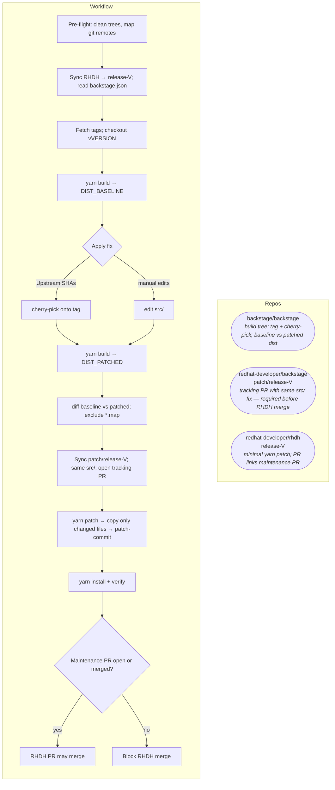

# rhdh-patch-backstage workflow (Mermaid)

Companion diagram for [`SKILL.md`](../SKILL.md). Render in GitHub, GitLab, VS Code (Mermaid preview), or docs tooling.

## Overview

**backstage/backstage** at the **`backstage.json`** tag is built twice; only differing dist files become the Yarn patch in **rhdh**. The same **`src/`** fix must also land as a tracking PR on **redhat-developer/backstage** **`patch/release-V`**. That tracking PR is a **merge gate** for the RHDH PR.

Step-by-step detail, troubleshooting, and **dynamic-plugins** (second Yarn project) are in [`SKILL.md`](../SKILL.md).
