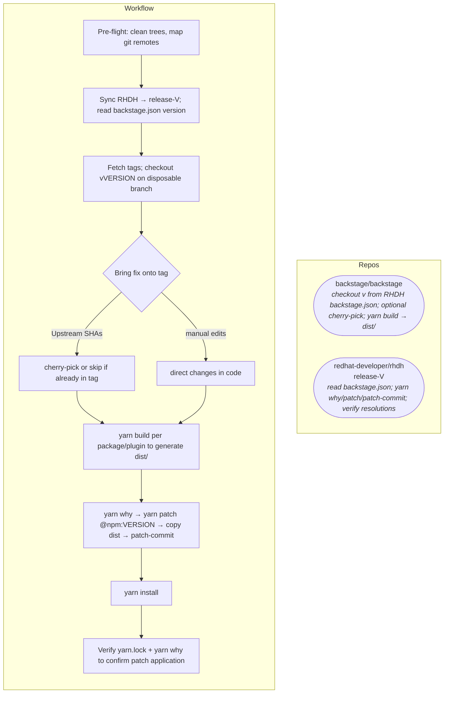

# rhdh-patch-backstage workflow (Mermaid)

Companion diagram for [`SKILL.md`](../SKILL.md). Render in GitHub, GitLab, VS Code (Mermaid preview), or docs tooling.

## Overview

One flow: **backstage/backstage** at the **`backstage.json`** release tag produces **`dist/`**; **RHDH** pins that onto the **lockfile version** with **`yarn patch`**. Upstream SHAs are cherry-picked onto that tag when needed.

Step-by-step detail, troubleshooting, and **dynamic-plugins** (second Yarn project) are in [`SKILL.md`](../SKILL.md).
